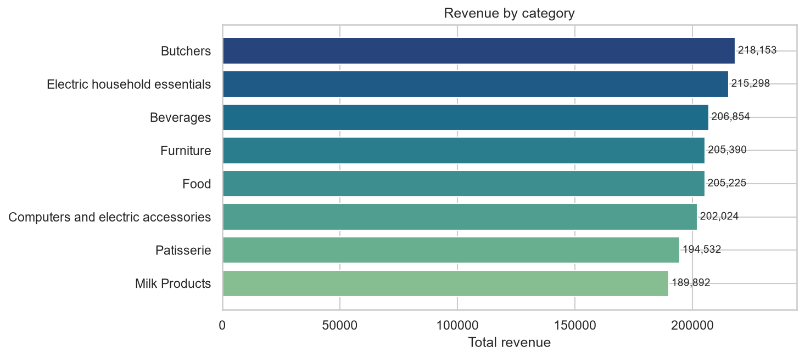
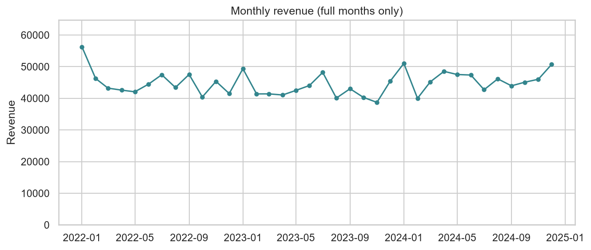
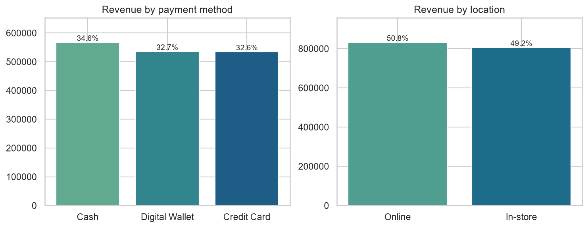

# Retail Store Sales: Data Cleaning & EDA

Cleaning and exploring a deliberately messy retail dataset: **12,575 transactions, 25 customers, 8 product categories, Jan 2022 to Jan 2025**.

The cleaning was first done in Excel (Google Sheets formulas, documented below), then rebuilt in pandas so every step is reproducible. The pandas steps mirror the Excel formulas one for one.

**Tools:** Python (pandas, NumPy, Matplotlib, Seaborn), Excel

## The problem

Five columns contained gaps, and the gaps were not random:

| Column | Missing | % of rows |
|---|---:|---:|
| Item | 1,213 | 9.65% |
| Price Per Unit | 609 | 4.84% |
| Quantity | 604 | 4.80% |
| Total Spent | 604 | 4.80% |
| Discount Applied | 4,199 | 33.39% |

Checking which columns were missing **together** showed what could be recovered exactly and what could only be estimated:

- Missing **Price** always came with a missing **Item**, but Quantity and Total were present, so `Price = Total / Quantity` is exact.
- Missing **Quantity** always came with a missing **Total Spent**, so nothing can recover it. It has to be estimated.

## Cleaning approach

Fixes depend on each other, so the order matters.

| Step | Column | Method | Rows |
|---|---|---|---:|
| 1 | Price Per Unit | `Total Spent / Quantity` | 609 |
| 2 | Item | Lookup on **Category + Price** | 1,213 |
| 3 | Quantity | Item-level average of observed values, rounded up to a whole number, **flagged** | 604 |
| 4 | Total Spent | `Price x Quantity` | 604 |
| 5 | Discount Applied | Blank becomes `UNKNOWN` | 4,199 |

### Decisions worth calling out

- **Item lookup uses Category + Price, not price alone.** Every one of the 25 price points is shared by all 8 categories, so a price-only lookup silently assigns the wrong item. This is the easiest mistake to make in this dataset. A price-only XLOOKUP I tried first overwrote about 85% of existing items, so the notebook asserts that every Category/Item/Price combination exists in the reference table.
- **Quantity is an estimate, and is labelled as one.** Quantity and Total Spent are always missing together, so neither can recover the other. Each gap is filled with the average observed quantity for that item, rounded up (5 to 7, mostly 6). Observed quantities are spread almost evenly across 1 to 10, so these are rough estimates. The 604 rows carry `Imputed_Flag = True`.
- **Discount is not assumed to be "no discount".** A third of rows have no discount information, so they are kept as `UNKNOWN` rather than counted as `False`.
- **Original values are never overwritten.** Only blanks are filled, and the notebook asserts it.

### Validation

The notebook ends the cleaning stage with hard assertions:

- no missing values remain and Transaction IDs are unique
- no original Item, Price, Quantity or Total value changed
- every Category/Item/Price combination exists in the reference table
- `Price x Quantity = Total Spent` in every row (the 11,971 original totals already agreed with it)
- Quantity stays between 1 and 10

## Excel approach (Google Sheets)

These are the formulas used to fix each issue. Each step reads the completed output of the step before it, so the order matters. `ARRAYFORMULA` is Google Sheets syntax; in Excel, drop it and use the rest as written.

| Step | Issue | Formula |
|---|---|---|
| 1 | Price missing | `=IF(ISBLANK(E2)=TRUE,(G2/F2), E2)` |
| 2 | Item missing | `=ARRAYFORMULA(XLOOKUP(1, (M$2:M$12576=M2) * (C$2:C$12576=C2) * (D$2:D$12576<>""),D$2:D$12576))` |
| 3 | Quantity missing | `=ARRAYFORMULA(IF(ISBLANK(F2), ROUNDUP(AVERAGEIF(D:D, D2, F:F), 0), F2))` |
| 4 | Total Spent | `=PRODUCT(E2,F2)` |
| 5 | Discount missing | `=IF(ISBLANK(K2),"UNKNOWN",K2)` |

How each one works:

1. **Price:** every missing price has Quantity and Total Spent present, so `Total / Quantity` is exact.
2. **Item:** matches on **Category and Price** among rows that already have an item. Price alone would be ambiguous because every price point is shared by all 8 categories. It is safe on every row, because a row that already has an item finds the same item.
3. **Quantity:** an item-level average of observed quantities, rounded up. `AVERAGEIF` ignores blanks, so only real values count.
4. **Total Spent:** price times quantity, using the completed price and quantity. Existing totals already agreed with this in every row.
5. **Discount:** blanks stay `UNKNOWN` instead of being counted as "no discount".

The pandas notebook reproduces each step in the same order.

## Key findings

Total revenue is **1,637,709** across 12,575 transactions (average 130.24, median 110.00). About 5.2% of that revenue comes from the flagged imputed rows.



- **Categories are closely matched.** Butchers leads with 13.3% of revenue and Milk Products trails with 11.6%. Milk Products also has the lowest average transaction (119.95 against 139.11 for Butchers).
- **Revenue is stable year to year**, at 540,658 in 2022, 515,588 in 2023 and 554,524 in 2024, with a monthly average of about 44,700.



- **Mild seasonality.** January is the strongest calendar month on average and October the weakest, a spread of about 24.4%.
- **Channels and payment methods are balanced.** Online brings in 50.8% of revenue and in-store 49.2%. Cash accounts for slightly more than cards or digital wallets, and average transaction values are within about 2.5 of each other.



- **Discounts show no visible effect on spend.** Average transaction value is 131.01 with a discount and 130.84 without, and quantity is nearly identical (5.56 against 5.60).
- **Customer spend is very even.** The top 5 of 25 customers account for 21.4% of revenue, close to the 20% an even split would give. The range per customer is 61,205 to 71,942.
- **Top items** are mostly the highest-priced item numbers (for example `Item_25_FUR` and `Item_25_EHE`), which is expected when price is static and purchase quantities are similar.

These patterns are flat largely because the dataset is **synthetic**, so they describe how the data was generated rather than real retail behaviour.

## Limitations

- 604 quantities (4.8% of rows) are estimates, and rounding up nudges them slightly high, so revenue totals are approximate for that share.
- Discount status is unknown for 33% of rows, so discount analysis only covers the known rows.
- Prices are static, so price-driven analysis such as elasticity or margin is not meaningful.
- Item names are codes (for example `Item_7_BEV`), not product names.
- The data is synthetic, so findings should not be generalised.

## Data dictionary (cleaned file)

| Column | Description |
|---|---|
| Transaction ID | Unique transaction identifier |
| Customer ID | One of 25 customers |
| Category | One of 8 product categories |
| Item | Item code, always consistent with Category |
| Price Per Unit | Static price per item |
| Quantity | Units purchased, a whole number from 1 to 10 |
| Total Spent | `Price Per Unit x Quantity` |
| Payment Method | Cash, Credit Card or Digital Wallet |
| Location | In-store or Online |
| Transaction Date | Date of the transaction |
| Discount Applied | `True`, `False` or `UNKNOWN` |
| Imputed_Flag | `True` where Quantity (and so Total Spent) was estimated |

## Repository structure

```
.
├── data/
│   ├── raw/retail_store_sales.xlsx
│   └── cleaned/retail_store_sales_cleaned.csv
├── notebooks/retail_sales_cleaning_and_eda.ipynb
├── images/
├── requirements.txt
└── README.md
```

## Run it yourself

```bash
pip install -r requirements.txt
jupyter notebook notebooks/retail_sales_cleaning_and_eda.ipynb
```

Run the notebook from the `notebooks/` folder. It reads the raw file and regenerates the cleaned CSV and charts.
